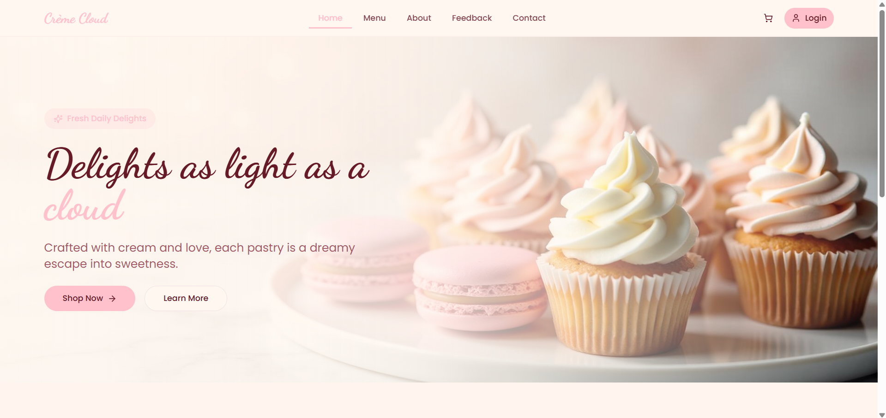
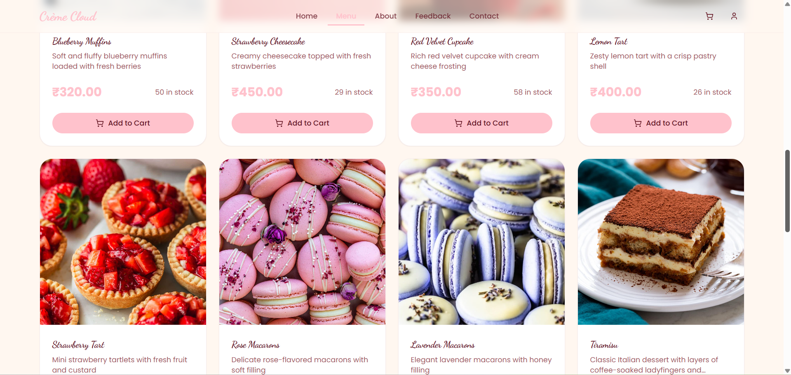
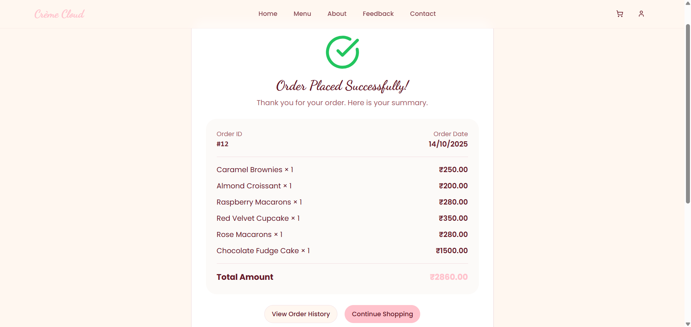

# Crème Cloud - Digital Patisserie

**Delights as light as a cloud, crafted with cream and love.**

Crème Cloud is a full-stack e-commerce platform developed as a DBMS mini-project. It features a responsive React frontend paired with a normalized relational database for seamless pastry ordering and inventory management.

## Features
- User authentication, profiles, and secure role-based access.
- Interactive product catalog with real-time stock indicators.
- Dynamic shopping cart and checkout flow.
- Persistent order history and transaction summaries.

## Tech Stack
* **Frontend**: React, TypeScript, Vite, Tailwind CSS.
* **UI Components**: Shadcn/UI, Lucide React, Sonner.
* **Backend/Database**: Supabase (PostgreSQL).
* **State Management**: React Context API (Auth & Cart).

## Database Architecture
The system utilizes a 3NF (Third Normal Form) relational schema to ensure data integrity and atomicity across all transactions.

### Core Entities
* **Profiles**: User identity and secure role-based access control (RBAC) handled via PostgreSQL triggers.
* **Products**: Comprehensive inventory tracking including stock levels, pricing, and categorization.
* **Orders and Order Items**: Relational join tables designed to resolve many-to-many relationships and maintain order history.

## Application Interface

  
   
  <em>Main Storefront and Hero Section</em>

  
  
   
  <em>Product Catalog and Successful Transaction Flow</em>

